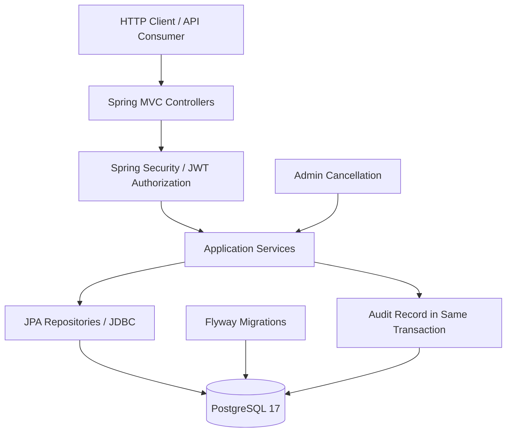

# CineReserve

**A Spring Boot cinema booking REST API focused on transactional seat reservations, concurrency correctness, and administrative accountability.**

CineReserve is a backend portfolio project built with Java 21, Spring Boot, and PostgreSQL. It models movies, cinema halls, seats, showtimes, and bookings, with JWT-based authentication and administrator-only operations. Its core design principle is that **the database must enforce booking correctness even when requests arrive concurrently**.

## Highlights

- **Concurrency-safe seat reservations:** a PostgreSQL partial unique index prevents two active reservations for the same seat at the same showtime.
- **Transactional cancellations:** booking and booked-seat statuses are updated together; an administrative cancellation also records an audit entry in the same transaction.
- **Role-based access control:** Spring Security protects customer and administrator endpoints using JWT bearer tokens.
- **Showtime integrity:** a PostgreSQL exclusion constraint prevents overlapping scheduled screenings in the same hall.
- **Repeatable schema changes:** Flyway migrations manage the PostgreSQL schema and constraints.
- **Automated verification:** JUnit and Spring Boot integration tests cover database constraints, concurrent requests, security boundaries, administration, and rollback behavior.
- **Containerized deployment:** a multi-stage Docker build and Docker Compose run the API alongside PostgreSQL.

## Tech Stack

| Area | Technology |
| --- | --- |
| Language | Java 21 |
| Backend | Spring Boot 4.1.x, Spring MVC |
| Security | Spring Security, JWT, BCrypt |
| Persistence | Spring Data JPA / Hibernate, JDBC |
| Database | PostgreSQL 17 |
| Database migrations | Flyway |
| Testing | JUnit 5, Spring Boot Test, MockMvc, Mockito |
| Build | Maven |
| Deployment | Docker, Docker Compose |

## Architecture



The Docker Compose deployment runs the API and PostgreSQL as separate services. Inside the Compose network, the API connects to `postgres:5432`, **not** `localhost:5432`.

## Core Domain

- **Movie:** catalog information and screening duration.
- **CinemaHall and Seat:** physical seating layout and unique seat positions within a hall.
- **Showtime:** a movie scheduled in a hall over a time interval.
- **Booking and BookingSeat:** customer reservations and their individual seat states.
- **AppUser:** authenticated account and role (`CUSTOMER` or `ADMIN`).
- **AdminBookingAudit:** accountability record for administrative booking cancellation.

### How Double Booking Is Prevented

The most important correctness rule is enforced in PostgreSQL:

```sql
CREATE UNIQUE INDEX uq_active_showtime_seat
ON booking_seat (showtime_id, seat_id)
WHERE status = 'RESERVED';
```

Two simultaneous transactions cannot successfully create **active** reservations for the same `(showtime_id, seat_id)`. Application-level validation is helpful for user feedback, but the database constraint provides the final guarantee against conflicting reservations.

Cancellation changes the relevant seat reservations from `RESERVED` to `CANCELLED`, allowing those seats to be reserved again. Booking and seat updates are part of a transaction, so partially applied cancellations are not accepted as successful results.

### How Overlapping Showtimes Are Prevented

The database has a GiST-backed exclusion constraint (`ex_showtime_hall_overlap`) on scheduled showtimes, using a time range. It prevents conflicting scheduled screenings in the same cinema hall while allowing adjacent, non-overlapping time ranges.

### Administrative Cancellation and Auditing

An administrator can cancel a customer's booking through a protected API. The cancellation operation:

1. Verifies administrative authorization.
2. Applies booking state checks and appropriate database locking.
3. Updates the booking and its reserved seats.
4. Inserts an `admin_booking_audit` record with the administrator, booking, action, reason, and timestamp.
5. Commits the changes together, or rolls them back together if an operation fails.

Repeated cancellation and nonexistent bookings are handled as distinct error cases (`409 Conflict` and `404 Not Found`, respectively).

## Getting Started with Docker Compose

### Prerequisites

- Docker Desktop or Docker Engine with Docker Compose
- Free host ports `8080` (API) and `5432` (PostgreSQL)

### 1. Configure environment variables

The Compose configuration requires `POSTGRES_PASSWORD` and `JWT_SECRET`. In **PowerShell**, for the current terminal session:

```powershell
$env:POSTGRES_PASSWORD = Read-Host "Existing PostgreSQL password"
$env:JWT_SECRET = Read-Host "JWT secret"
```

Use a sufficiently strong JWT signing secret compatible with the application's HS256 configuration. If using an **existing PostgreSQL data volume**, the password must match the password already assigned to the `cinereserve` database role: changing `POSTGRES_PASSWORD` alone does not change an existing database password.

**Do not commit real passwords, JWT secrets, or `.env` files.**

### 2. Build and start

```powershell
docker compose config --quiet
docker compose up -d --build
```

### 3. Check status and logs

```powershell
docker compose ps
docker compose logs --tail=100 app
```

The API is exposed at **`http://localhost:8080`** and PostgreSQL at **`127.0.0.1:5432`** for local development. Flyway runs when the Spring Boot application starts.

### 4. Verify access control

```powershell
curl.exe -i http://localhost:8080/api/v1/admin/bookings
```

An unauthenticated request to this protected endpoint should return `401 Unauthorized`.

### 5. Stop services without deleting data

```powershell
docker compose down
```

**Do not use `docker compose down -v` unless you intentionally want to delete the PostgreSQL volume.**

## API Overview

The verified administrative routes are:

| Method | Endpoint | Purpose |
| --- | --- | --- |
| `GET` | `/api/v1/admin/bookings` | Paginated booking search; optional `userId`, `email`, `displayName`, `page`, `size` |
| `GET` | `/api/v1/admin/bookings/{id}` | Booking details |
| `PATCH` | `/api/v1/admin/bookings/{id}/cancel` | Cancel a booking with a JSON `reason` |
| `GET` | `/api/v1/admin/booking-audits` | Paginated audit search; optional `bookingId`, `adminId`, `page`, `size` |
| `GET` | `/api/v1/admin/booking-audits/{id}` | Audit entry details |

The application also includes customer-facing authentication, movie, hall, seat, showtime, and booking functionality. Consult the corresponding controllers for their exact paths and request contracts.

### Example admin cancellation request

```http
PATCH /api/v1/admin/bookings/123/cancel
Authorization: Bearer <ADMIN_JWT>
Content-Type: application/json

{
  "reason": "Screening unavailable due to maintenance"
}
```

All `/api/v1/admin/**` operations require appropriate administrator privileges. Customer accounts are not allowed to use these routes.

## Local Development

With PostgreSQL running and the application environment variables configured, run the Spring Boot application through your IDE or Maven. When Spring Boot runs **on your host machine**, its PostgreSQL URL should use `localhost:5432`; when Spring Boot runs **inside Compose**, the URL uses `postgres:5432`.

```powershell
mvn spring-boot:run
```

Avoid running the host application and the Dockerized application on port `8080` simultaneously.

## Automated Tests

The test suite includes:

- Unit tests for domain/application behavior.
- Database constraint tests for showtime overlap and unique seat reservations.
- Concurrent booking tests, including HTTP-level and service-level scenarios.
- JWT and administrator authorization tests (`401` vs. `403`).
- Administrative cancellation tests (`200`, `404`, `409`).
- Audit creation, audit query, and transactional rollback tests.
- Booking administration filtering and pagination tests.

Run the suite with the **test profile**:

```powershell
mvn clean test "-Dspring.profiles.active=test"
```

**Important:** Integration tests use a separate PostgreSQL database named `cinereserve_test`. Create/configure that database before running tests, and verify `src/test/resources/application-test.yaml` points to it. Tests create and remove records; never run them against the development `cinereserve` database.

A successful test run is the source of truth for the current number of passing tests. No hard-coded passing count is claimed here.

## Performance Review

A preliminary review used PostgreSQL `EXPLAIN (ANALYZE, BUFFERS)` against a small local data set. Sample results were:

| Query shape | Observed execution time |
| --- | ---: |
| Booking lookup by user | 0.104 ms |
| Simplified admin booking search with user join | 1.146 ms |
| Admin audit search by administrator | 0.213 ms |

These measurements are **not production benchmarks**. The database contained only a few booking and audit records, and the sampled audit query returned no rows. PostgreSQL's use of sequential scans for very small tables is expected; additional indexes should be justified with representative workloads rather than added speculatively.

## Engineering Decisions

- **PostgreSQL constraints before distributed locks:** database-enforced rules remain correct across concurrent API requests.
- **Transactions for consistency:** booking state, seat state, and administrative audit data are committed atomically.
- **Test database isolation:** integration tests run against a separate schema/database environment.
- **No unnecessary infrastructure:** Redis and message queues are deliberately excluded until a measured requirement justifies them.
- **Readability over complexity:** APIs and domain rules are organized for maintainability and straightforward code review.

## Future Improvements

- Run performance tests with larger, representative data sets.
- Add API documentation using OpenAPI/Swagger.
- Introduce CI to execute unit/integration tests on each pull request.
- Add deployment health/observability features if deploying beyond local Docker Compose.

## Project Status

Core backend functionality, database constraints, authentication and authorization, automated tests, and Docker Compose deployment have been implemented. The project is intended to demonstrate backend engineering fundamentals rather than present itself as a production-operated ticketing platform.
